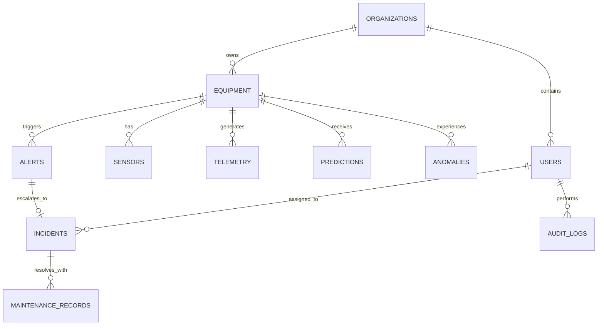

# InfraSentinel AI — Architecture & System Design Document

## 1. System Overview
**InfraSentinel AI** is an enterprise-grade AI/ML predictive maintenance, real-time anomaly detection, and incident response platform tailored for critical industrial infrastructure (pumps, electric motors, power systems, compressors, and rotating machinery).

The platform bridges real-time telemetry streaming, unsupervised anomaly detection (Isolation Forest), supervised failure risk prediction (Random Forest & XGBoost with class-imbalance weighting), local model explainability (SHAP value attribution & feature importance), automated rule-based alert triggering, and full-lifecycle incident response tracking with enterprise role-based access control.

```
+-------------------------------------------------------------------------------------------------------------+
|                                              PRESENTATION LAYER                                             |
|   Next.js App Router (TypeScript, Tailwind CSS, Framer Motion, Lucide, Recharts / ECharts, Zustand)         |
|   - Real-Time Telemetry Dashboard           - Interactive Incident Command Center                           |
|   - AI Prediction & SHAP Visualizer         - Equipment Health Matrix & Topology                            |
|   - Live Anomaly Timeline & Telemetry Feed  - Model Performance & Calibration Metrics                       |
+-------------------------------------------------------------------------------------------------------------+
                                       ▲ WebSocket / REST APIs (v1)
                                       ▼
+-------------------------------------------------------------------------------------------------------------+
|                                             APPLICATION SERVICES                                            |
|   FastAPI (Python 3.11, Pydantic v2, SQLAlchemy 2.0 Async/Sync, JWT Auth, Role Guard)                       |
|   - /api/v1/auth & /users                   - /api/v1/equipment & /sensors                                  |
|   - /api/v1/telemetry (ingest & query)      - /api/v1/predictions & /anomalies                              |
|   - /api/v1/alerts & /incidents             - /api/v1/maintenance & /analytics                              |
|   - /api/v1/models & /datasets              - /ws/telemetry (Live Broadcast Stream)                         |
+-------------------------------------------------------------------------------------------------------------+
            │                                             │                                      │
            ▼                                             ▼                                      ▼
+-----------------------+                    +-------------------------+            +-------------------------+
|     DATA LAYER        |                    |   AI / ML ENGINE        |            |   TELEMETRY SIMULATOR   |
| PostgreSQL / SQLite   |                    | - XGBoost / Random Forest|           | - Configurable scenarios|
| - Equipment & Sensors |                    | - Isolation Forest      |            | - Normal, Heat, Vib,    |
| - Telemetry Timeseries|                    | - SHAP Attribution      |            |   Overload, Degradation |
| - Predictions & Alerts|                    | - Real-time Inference   |            | - WebSocket / REST push |
| - Incidents & Audits  |                    | - Metric Tracking       |            | - Rate control & jitter |
+-----------------------+                    +-------------------------+            +-------------------------+
```

---

## 2. Component Architecture

### 2.1 Monorepo Structure
```
infrasentinel/
├── apps/
│   └── web/                   # Next.js 14/15 App Router, Tailwind, Framer Motion, Lucide, Recharts/ECharts, Zustand, TanStack Query
├── services/
│   └── api/                   # FastAPI, SQLAlchemy 2.0, Pydantic v2, WebSockets, Alembic
│       ├── app/
│       │   ├── api/v1/        # endpoints: auth, equipment, sensors, telemetry, predictions, anomalies, alerts, incidents, maintenance, datasets, models, analytics, reports
│       │   ├── core/          # config, security, database, logging
│       │   ├── models/        # SQLAlchemy ORM models
│       │   ├── schemas/       # Pydantic schemas
│       │   ├── services/      # Business logic: alert engine, incident management, inference, explainability
│       │   ├── websocket/     # Telemetry streaming broadcaster
│       │   └── ml/            # Model runner & artifacts loader
│       ├── tests/
│       └── alembic/
├── ml/
│   ├── datasets/              # AI4I 2020 raw & processed
│   ├── training/              # Training scripts: baseline, logistic reg, random forest, xgboost/lightgbm, isolation forest
│   ├── evaluation/            # Metrics calculation, confusion matrix, calibration, PR-AUC, ROC-AUC
│   └── artifacts/             # Serialized joblib models & feature metadata & SHAP background
├── simulator/                 # Standalone/integrated telemetry simulator engine
├── packages/
│   └── shared/                # Shared TS types / schemas
├── infrastructure/
│   └── docker/                # Dockerfiles for api and web
├── docs/                      # System documentation
├── scripts/                   # Setup, seed, train, run scripts
├── docker-compose.yml
├── .env.example
└── README.md
```

### 2.2 Frontend Architecture
- **Framework**: Next.js App Router (React 19/18, TypeScript strict mode).
- **Styling**: Tailwind CSS with custom enterprise industrial dark color tokens:
  - Deep Navy Canvas: `#060B16`
  - Secondary Panel: `#0B1220`
  - Card Glass Layer: `#111C2E`
  - Accents: Electric Blue `#3B82F6`, Cyan Glow `#22D3EE`, Amber Warning `#F59E0B`, Danger Red `#EF4444`, Success Green `#22C55E`.
- **State Management**: Zustand for global real-time telemetry buffer and simulator control, TanStack Query for server state caching and optimistic updates.
- **Visualizations**: Dynamic Recharts / SVG time-series charts with threshold bands, anomaly overlays, and SHAP feature importance horizontal bar graphs.
- **Real-Time Client**: Resilient WebSocket subscriber with auto-reconnection and buffer smoothing.

### 2.3 Backend Architecture
- **Framework**: FastAPI (ASGI), Python 3.11+.
- **Database ORM**: SQLAlchemy 2.0 with PostgreSQL 16 (and SQLite zero-config fallback mode for instant local testing).
- **Authentication**: JWT (JSON Web Tokens) with PBKDF2/bcrypt hashing, refresh handling, and RBAC (Roles: `operator`, `engineer`, `admin`, `auditor`).
- **Telemetry Streaming**: Fast in-memory pub-sub connection manager (`ConnectionManager`) dispatching real-time broadcast frames to connected WebSocket clients.
- **Inference Service**: In-memory loaded scikit-learn / XGBoost pipelines with cached SHAP TreeExplainer instances for sub-15ms prediction latency.

### 2.4 ML & Inference Architecture
- **Supervised Models**:
  - Baseline: Logistic Regression (balanced class weight).
  - Production: Random Forest Classifier & XGBoost Classifier with calibrated probabilities.
- **Unsupervised Anomaly Model**:
  - Isolation Forest trained on healthy operating regimes to flag out-of-distribution multi-sensor states.
- **Explainability**:
  - SHAP (SHapley Additive exPlanations) values computed via TreeExplainer on real sensor features.
  - Deterministic fallbacks providing top contributing sensor deviations against standard equipment baseline.
- **Strict Separation**: Anomaly score (distance from normal distribution, 0 to 1) is never confounded with calibrated failure risk probability (likelihood of mechanical failure within observation horizon).

---

## 3. Database Schema Design (Entities & Relations)



- **`organizations`**: Multi-tenant boundary (`id`, `name`, `slug`, `created_at`).
- **`users`**: User identity (`id`, `org_id`, `email`, `hashed_password`, `full_name`, `role`, `is_active`).
- **`equipment`**: Monitored assets (`id`, `org_id`, `name`, `code`, `equipment_type`, `model_number`, `location`, `status`, `health_score`, `created_at`).
- **`sensors`**: Configured telemetry channels (`id`, `equipment_id`, `sensor_type`, `unit`, `min_threshold`, `max_threshold`, `warning_threshold`).
- **`telemetry`**: Sensor measurement stream (`id`, `equipment_id`, `timestamp`, `air_temp_k`, `process_temp_k`, `rotational_speed_rpm`, `torque_nm`, `tool_wear_min`, `vibration_mms`, `pressure_bar`, `raw_payload`).
- **`predictions`**: Supervised failure risk scores (`id`, `equipment_id`, `model_version`, `failure_risk_probability`, `risk_category`, `predicted_failure_type`, `feature_importance_json`, `timestamp`).
- **`anomalies`**: Unsupervised anomaly detections (`id`, `equipment_id`, `anomaly_score`, `is_anomaly`, `affected_sensors`, `details_json`, `timestamp`).
- **`alerts`**: Real-time notifications (`id`, `equipment_id`, `rule_code`, `severity`, `title`, `message`, `status`, `triggered_value`, `acknowledged_by`, `acknowledged_at`, `timestamp`).
- **`incidents`**: Formal tickets (`id`, `equipment_id`, `alert_id`, `incident_number`, `title`, `description`, `severity`, `status`, `priority`, `assigned_to_user_id`, `created_at`, `resolved_at`).
- **`maintenance_records`**: Work orders and logs (`id`, `equipment_id`, `incident_id`, `maintenance_type`, `technician_name`, `actions_performed`, `parts_replaced`, `downtime_minutes`, `cost`, `performed_at`).
- **`model_versions`**: Audit of trained ML artifacts (`id`, `name`, `version`, `algorithm`, `metrics_json`, `hyperparameters_json`, `artifact_path`, `is_active`, `trained_at`).
- **`audit_logs`**: System audit trail (`id`, `user_id`, `action`, `resource_type`, `resource_id`, `details_json`, `timestamp`).

---

## 4. Security & Compliance
1. **Tenant Isolation**: Every database query filters by `org_id`.
2. **Password Cryptography**: Passwords salted and hashed with PBKDF2/bcrypt.
3. **No Direct Physical Control**: Explicit read-only and decision-support boundaries ensure no actuator control commands are ever issued.
4. **CORS & Input Validation**: Strict CORS origins and complete Pydantic model schemas validating all payload boundaries.
